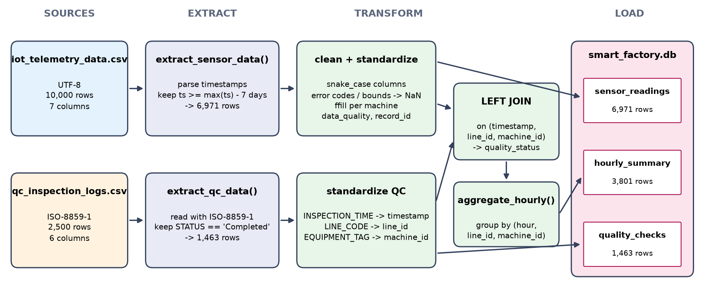
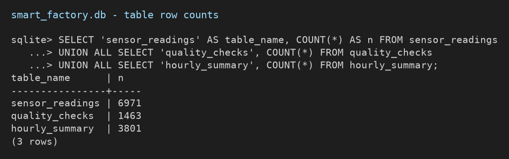
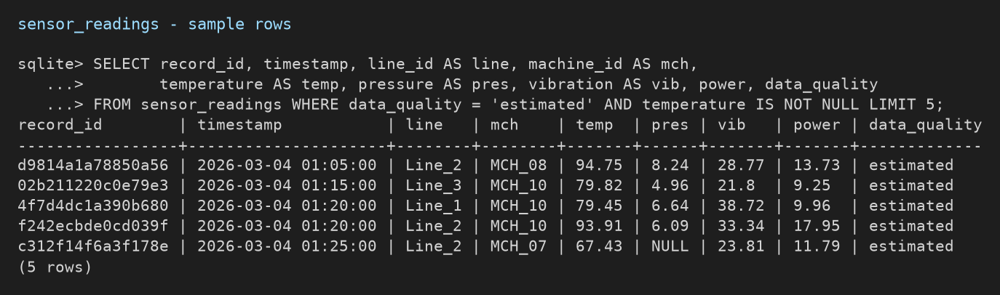
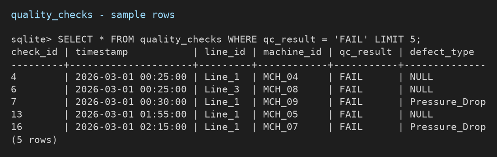
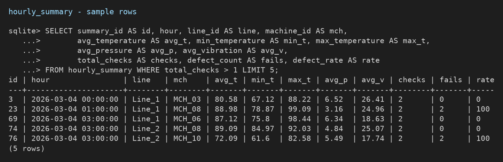
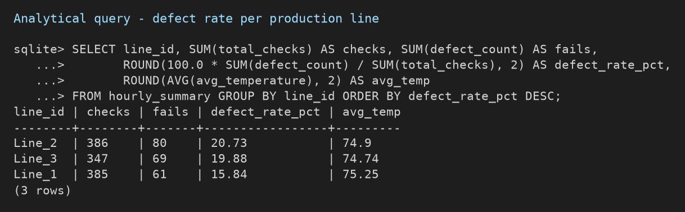

# Smart Factory ETL Pipeline

A Python ETL pipeline that cleans and integrates **machine telemetry** and **quality-control inspection logs**,
then loads them into a centralized SQLite database (`smart_factory.db`).

## Deliverables

| # | Deliverable | Link |
|---|---|---|
| 1 | ETL script | [`etl_pipeline.py`](etl_pipeline.py) |
| 2 | SQLite database (3 populated tables) | [`smart_factory.db`](smart_factory.db) (download, then open with [DB Browser for SQLite](https://sqlitebrowser.org/)) |
| 3 | Engineering report (3 pages, PDF) | [`report/ETL_Engineering_Report.pdf`](report/ETL_Engineering_Report.pdf) |
| 4 | Video: code structure + end-to-end run | _to be added_ |

Source data: [`data/iot_telemetry_data.csv`](data/iot_telemetry_data.csv) (UTF-8) and
[`data/qc_inspection_logs.csv`](data/qc_inspection_logs.csv) (ISO-8859-1).

---

## Architecture and data flow



| Phase | Function | What it does |
|---|---|---|
| Extract | `extract_sensor_data()` | Reads telemetry, keeps the **last 7 days** relative to the latest timestamp (10,000 → 6,971 rows) |
| Extract | `extract_qc_data()` | Reads the log as **ISO-8859-1**, keeps `INSPECTION_STATUS == 'Completed'` (2,500 → 1,463 rows) |
| Transform | `standardize_sensor_schema()`, `standardize_qc_schema()` | snake_case names; `INSPECTION_TIME → timestamp`, `LINE_CODE → line_id`, `EQUIPMENT_TAG → machine_id`; datetimes |
| Transform | `clean_sensor_data()` | Error codes (-999.0, -1.0) and nulls → NaN; out-of-bounds values → NaN; **forward-fill per machine**; `data_quality` = good / estimated |
| Transform | `add_record_id()` | Unique SHA-1-based `record_id` per sensor row |
| Transform | `join_sensor_quality()` | **Left join** sensor ← QC on `(timestamp, line_id, machine_id)`; `quality_status` = PASS / FAIL / NOT_CHECKED |
| Transform | `aggregate_hourly()` | Per (hour, line, machine): avg/min/max of temperature, pressure, vibration; `total_checks`, `defect_count`, `defect_rate` |
| Load | `load_to_sqlite()` | Creates the 3 tables and loads them in **one transaction** (all-or-nothing, safe to re-run) |

Every stage uses `try/except` and raises a clear `ETLError` (missing file, bad encoding, malformed CSV,
missing column, SQLite error) instead of crashing.

---

## Results

### Loaded tables

| Table | Rows | Primary key |
|---|---:|---|
| `sensor_readings` | 6,971 | `record_id` (SHA-1 based) |
| `quality_checks` | 1,463 | `check_id` AUTOINCREMENT |
| `hourly_summary` | 3,801 | `summary_id` AUTOINCREMENT |

### Data cleaning

| Signal | Valid range | Error codes → NaN | Out of range | Repaired by |
|---|---|---:|---:|---|
| Temperature | 0 – 150 °C | 278 (`-999.0`) | 0 | forward-fill |
| Pressure | 0 – 10 bar | 199 (`-1.0`) | 57 | forward-fill |
| Vibration | 0 – 100 mm/s | 0 | 152 | forward-fill |

**6,287** readings are `good` and **684** are `estimated`. Five values stay NULL because the invalid
reading was that machine's first one in the window, so there was no earlier value to fill from.

### Join result

| quality_status | Sensor rows |
|---|---:|
| PASS | 908 |
| FAIL | 210 |
| NOT_CHECKED | 5,853 |

### Defect rate per production line

| Line | Checks | Fails | Defect rate | Avg temperature |
|---|---:|---:|---:|---:|
| Line_2 | 386 | 80 | **20.73 %** | 74.90 °C |
| Line_3 | 347 | 69 | 19.88 % | 74.74 °C |
| Line_1 | 385 | 61 | 15.84 % | 75.25 °C |

### Machines with the highest defect rate

| Line | Machine | Checks | Fails | Defect rate |
|---|---|---:|---:|---:|
| Line_2 | MCH_08 | 34 | 11 | 32.35 % |
| Line_3 | MCH_06 | 36 | 11 | 30.56 % |
| Line_2 | MCH_05 | 46 | 13 | 28.26 % |
| Line_1 | MCH_04 | 31 | 8 | 25.81 % |
| Line_2 | MCH_10 | 24 | 6 | 25.00 % |

### Failed inspections by defect type

| Defect type | Count |
|---|---:|
| Pressure_Drop | 88 |
| Thermal_Spike | 72 |
| High_Vibration | 65 |
| (not recorded) | 53 |

### Sample query execution







---

## Design decisions

- **Duplicate sensor readings:** the raw file repeats 556 `(timestamp, line_id, machine_id)` keys, so
  `record_id` hashes the key **plus the source row number** to stay unique.
- **Duplicate QC records:** 7 completed inspections share a key. For the join only, one record per key is
  kept, with **FAIL taking precedence over PASS**; the join is validated `many_to_one`, so it never
  duplicates sensor rows. `quality_checks` still stores all 1,463 inspections.
- **Forward-fill per machine:** rows are sorted by time within `(line_id, machine_id)` before `ffill()`,
  so a machine never inherits another machine's reading.
- **`defect_rate` is NULL** for hours with no inspection, rather than a misleading 0 %.

---

## How to run

```bash
git clone https://github.com/Wi-x-ssou/Smart_Factory_ETL.git
cd Smart_Factory_ETL
pip install -r requirements.txt
python etl_pipeline.py              # rebuilds smart_factory.db
python report/build_report.py       # optional: rebuilds the report figures and PDF
```

Options: `python etl_pipeline.py --data-dir <folder> --db <file>`.

```
Smart_Factory_ETL/
├── etl_pipeline.py            ETL pipeline (Extract → Transform → Load)
├── smart_factory.db           output database
├── data/                      source CSV files
├── report/
│   ├── ETL_Engineering_Report.pdf
│   ├── build_report.py        builds the report from the database
│   └── figures/               diagram and query screenshots
└── requirements.txt
```
